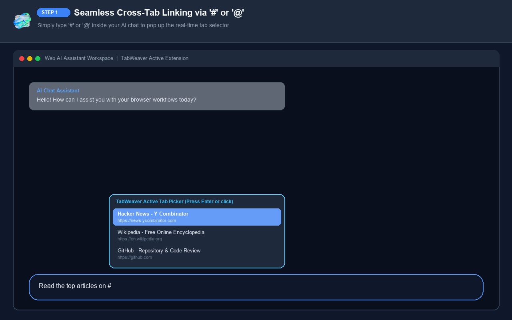
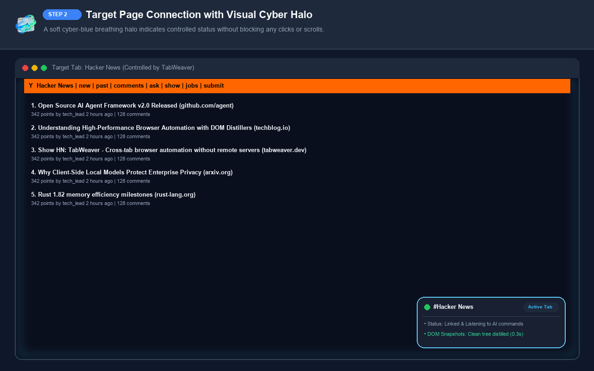

# 📝 TabWeaver 全渠道内容投稿包（Dev.to / V2EX / 阮一峰周刊）

---

## 一、 Dev.to 英文技术深度长文（高权重 SEO & GEO 首选）

*   **发布直达链接**：[https://dev.to/new](https://dev.to/new)
*   **Title**：`How I Built a Pure Client-Side Cross-Tab AI Bridge on Manifest V3 (Zero Backend Relays)`
*   **Tags**：`chromeextension`, `ai`, `opensource`, `javascript`
*   **Cover Image**：直接使用项目中 `images/promo-marquee-1400x560.png` 或 `docs/assets/screenshots/01-tag-picker-invoke.png`

### 正文 Markdown（全篇直接复制发布）：

```markdown
Most AI browser agents today work in one of two ways:
1. They spin up a remote cloud browser (expensive, blocked by corporate SSO/2FA).
2. They pipe your active webpage DOM through their own backend servers before hitting an LLM API (huge privacy red flag, plus you have to pay for extra API keys).

I wanted something radically simpler and 100% private: **use the web AI chats I already have open (ChatGPT, Claude, DeepSeek, Gemini, Kimi) to inspect and control another open, logged-in tab locally—with zero servers.**

That's why I built **[TabWeaver](https://github.com/zpzxgcr/TabWeaver)** (MIT licensed, zero build step, pure Manifest V3).



---

### The Core Bottleneck: Raw HTML Destroys Token Budgets

If you grab `document.documentElement.outerHTML` from modern web apps like Google Analytics, Jira, or GitHub, you easily end up with 50,000+ characters of SVG paths, inline scripts, hidden nodes, and CSS noise.

To solve this natively in the browser, I wrote a **Viewport & Overlay-Aware DOM Distiller** (`dom-distiller.js`):
1. **Top-Layer Priority**: Active modals, dialogs, and popovers get top extraction priority so search overlays aren't buried under static headers.
2. **Interactive Element Indexing**: Visible buttons, links, inputs, and selects receive lightweight `data-ext-elem-id` anchors.
3. **Aggressive Noise Stripping**: Tracking scripts, empty anchors, and hidden trees are stripped inside the client sandbox before serialization—cutting token usage by 80%+.

---

### How the Dual-Tab Handshake Works

1. **Mention to Link**: Type `#` or `@` inside any of the 18 supported web AI composers. An inline tab picker pops up showing all open tabs in your current window.
2. **Visual Proof**: The moment a target tab connects, TabWeaver renders a subtle **Cyber Breathing Halo** (`02-target-breathing-halo.png`) along the viewport border so you always know which tab is active.
3. **Structured Action Loop**: The AI outputs compact JSON actions (`click`, `fill`, `select`, `scroll`, `extract`, `navigate`, `finish`), executed locally via `chrome.scripting` and `action-executor.js`.



---

### Why "Logged-In Web Apps" Is the Sweet Spot

Because execution lives strictly inside your authenticated local Chrome profile:
- You can summarize and analyze **Google Analytics 4**, **Jira**, **Gmail**, or **internal dashboards** behind logins without exposing cookies to any external relay.
- You don't pay a cent for extra API wrappers—it runs directly on your existing ChatGPT / Claude / DeepSeek web session.

### Try It & Inspect the Code
- ⭐ **GitHub (MIT, pure JS)**: https://github.com/zpzxgcr/TabWeaver
- 🛒 **Chrome Web Store**: https://chromewebstore.google.com/detail/tabweaver-cross-tab-ai-br/allofpdkpijflgipdonjfgicgeajelen
- 🌐 **Website & Interactive Demo**: https://zpzxgcr.github.io/TabWeaver/

Would love to hear how you handle DOM distillation or Manifest V3 cross-tab messaging in your extensions!
```

---

## 二、 V2EX「分享创造」中文自荐帖

*   **发布直达链接**：[https://www.v2ex.com/new/create](https://www.v2ex.com/new/create)
*   **节点**：`分享创造`
*   **标题**：`开源了一个纯本地运行的 Chrome 扩展 TabWeaver：直接在 DeepSeek / ChatGPT 聊天框里用 # 号联动操作已登录的其他标签页`

### 正文 Markdown（直接复制发布）：

```markdown
大家好，最近开源了一个纯客户端运行的 Chrome Manifest V3 扩展项目 —— **TabWeaver**（MIT 协议，无构建步骤，无任何后端服务器）。

### 为什么做这个工具？
日常用网页版 AI（DeepSeek、Kimi、ChatGPT、Claude、豆包等）时，经常遇到两个很别扭的痛点：
1. **想让 AI 总结或操作需要登录的网页**（比如 Google Analytics 后台、公司内网 Jira、个人后台报表），市面上的云端 Agent 过不了本地 Cookie/SSO/2FA 登录墙，而很多商业侧边栏插件又必须把网页 DOM 传到他们自己的中继服务器，非常不放心；
2. **自己手动全选复制网页**不仅格式乱、长页面还要分几次贴，遇到弹窗/翻页更是没法让 AI 联动。

### TabWeaver 是怎么解决的？
不需要额外买 API Key，直接复用你已经打开且订阅/免费使用的 **18 个主流 AI 聊天网页**：
1. **在 AI 输入框里键入 `#` 或 `@`**：会像微信 @人 一样弹出当前窗口的所有标签页选择器；
2. **纯本地 DOM 语义蒸馏**：在本地浏览器沙箱内过滤掉脚本、SVG 和不可见噪音节点（对活动弹窗/Dialog 优先提取），只把紧凑的页面结构与正文发给你的 AI 对话；
3. **双向动作闭环**：目标页面顶部会亮起「赛博呼吸光环」作为视觉反馈，AI 可以自主输出动作指令完成点击、填表、下拉选择、滚动翻页并回传汇总结论；
4. **100% 留存本地**：没有任何第三方中继服务器，你的 Cookie 和页面隐私只在你的本地 Chrome 和你选用的 AI 官网之间流动。

### 适用场景举例
- 📊 让 DeepSeek / ChatGPT 直接帮你切换并总结已登录的 GA4 / 广告数据后台；
- 🏢 在企业内网安全汇总私有文档、Jira 工单或邮件长上下文；
- 🔁 跨标签页“看 A 网页资料，自动填 B 网页复杂表单”（最后提交按钮自己人工把关点）。

项目已通过审核正式上架 Chrome 应用商店，代码全部开源透明：
- 🛒 **Chrome 应用商店**：https://chromewebstore.google.com/detail/tabweaver-cross-tab-ai-br/allofpdkpijflgipdonjfgicgeajelen
- ⭐ **GitHub 开源仓库**：https://github.com/zpzxgcr/TabWeaver
- 🌐 **官网文档**：https://zpzxgcr.github.io/TabWeaver/

欢迎大家体验拍砖，如果觉得思路有用，麻烦顺手点个 Star 支持一下！🙏
```

---

## 三、 阮一峰《科技爱好者周刊》官方自荐 Issue 模板

*   **提交直达链接**：[https://github.com/ruanyf/weekly/issues/new](https://github.com/ruanyf/weekly/issues/new)
*   **Issue 标题**：`推荐开源项目 TabWeaver：在 AI 聊天网页中用 # 号直接读取并联动操控其他标签页（纯本地 Manifest V3）`

### Issue 内容（直接复制提交）：

```markdown
1. **项目名称**：TabWeaver
2. **项目地址**：https://github.com/zpzxgcr/TabWeaver （[Chrome 应用商店](https://chromewebstore.google.com/detail/tabweaver-cross-tab-ai-br/allofpdkpijflgipdonjfgicgeajelen)）
3. **类别**：工具 / 浏览器扩展
4. **一句话介绍**：无需后端服务器与额外 API Key，在 DeepSeek、ChatGPT、Claude、Kimi 等 18 个主流 AI 聊天网页里键入 `#` 即可选中当前窗口的已登录标签页，在本地沙箱完成 DOM 语义蒸馏与跨标签页自动化操作。
5. **项目特色**：
   - **安全留存本地**：无任何第三方云端中继，Cookie 与内网/后台数据完全留在本地 Chrome，专门解决云端 Agent 无法处理需授权登录网页的痛点；
   - **纯原生零构建**：纯 Manifest V3 原生 JS 实现，无打包步骤，MIT 协议开源；
   - **双向可视化反馈**：连接目标标签页时显示呼吸光环与悬浮执行状态胶囊。
6. **界面截图**：

```
